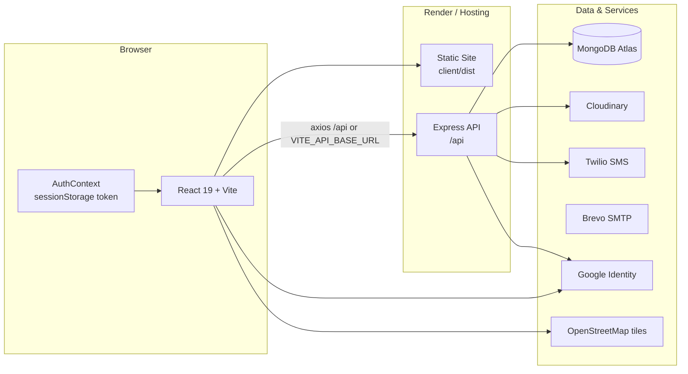
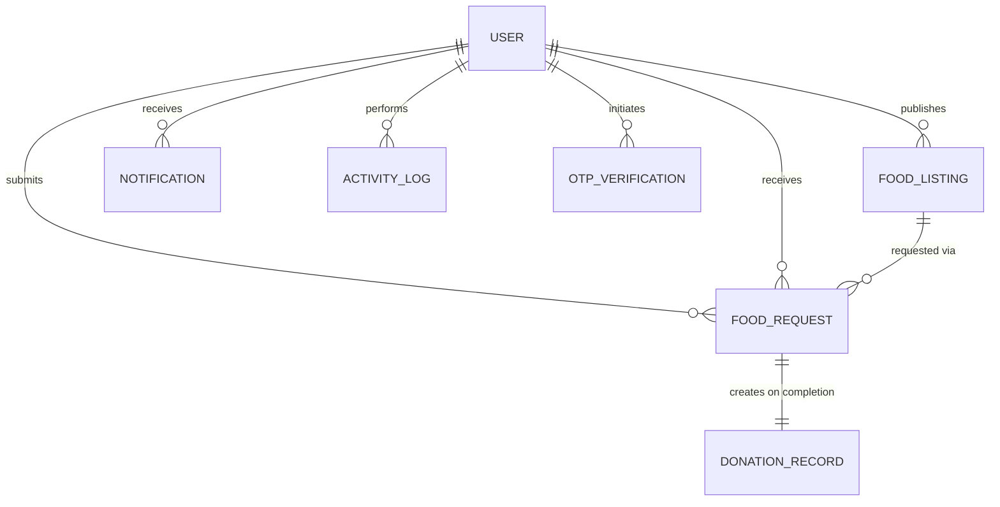
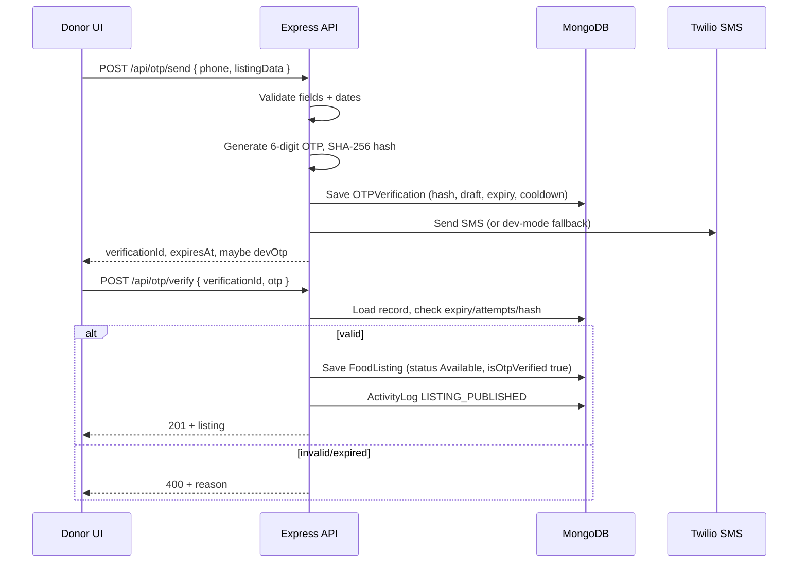
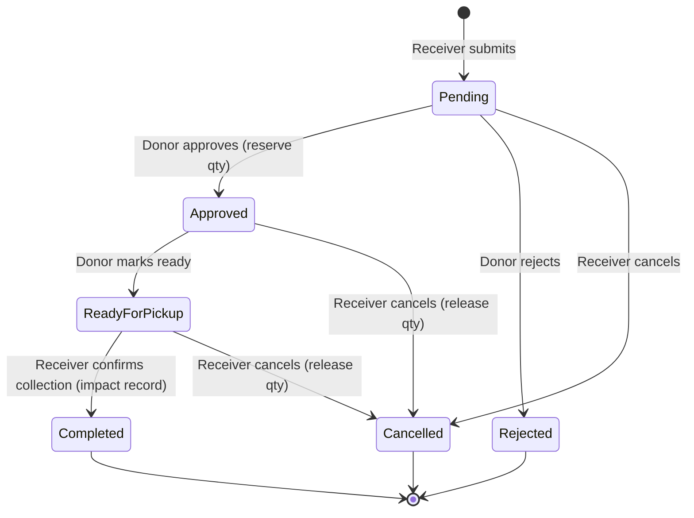

# Food Link — Project Documentation

> **Tagline:** *Good food deserves another chance.*
>
> Food Link is a full-stack community food-rescue platform that connects surplus food donors (restaurants, supermarkets, bakeries, households) with receivers (NGOs, orphanages, shelters, community kitchens, and individuals). Donors publish verified surplus-food listings; receivers request what they need; the platform tracks approval, pickup, collection, notifications, and measurable impact.

---

## Table of Contents

1. [Project at a Glance](#1-project-at-a-glance)
2. [Feature Overview](#2-feature-overview)
3. [Technology Stack](#3-technology-stack)
4. [System Architecture](#4-system-architecture)
5. [Repository Structure](#5-repository-structure)
6. [Data Models](#6-data-models)
7. [Authentication & Security](#7-authentication--security)
8. [Core Business Flows](#8-core-business-flows)
9. [API Reference](#9-api-reference)
10. [Frontend Documentation](#10-frontend-documentation)
11. [Design System & Animation](#11-design-system--animation)
12. [Local Development Setup](#12-local-development-setup)
13. [Environment Variables](#13-environment-variables)
14. [Scripts & Testing](#14-scripts--testing)
15. [Deployment](#15-deployment)
16. [Known Limitations & Operational Notes](#16-known-limitations--operational-notes)
17. [Roadmap Status](#17-roadmap-status)
18. [Troubleshooting & FAQ](#18-troubleshooting--faq)

---

## 1. Project at a Glance

| Item | Detail |
| --- | --- |
| **Project name** | Food Link |
| **Type** | Full-stack MERN-style web application (React + Express + MongoDB) |
| **Purpose** | Reduce food waste and improve food access by moving surplus food to verified community receivers |
| **Primary users** | Donors, Receivers (NGOs/shelters/individuals), Administrators |
| **Frontend** | React 19 + Vite 6 + Tailwind CSS 3 |
| **Backend** | Node.js + Express 4 + Mongoose 8 |
| **Database** | MongoDB Atlas |
| **Authentication** | JWT (HttpOnly cookie + Bearer fallback), bcrypt, Google OAuth |
| **External services** | Cloudinary (images), Twilio (SMS OTP), Brevo SMTP (transactional email), Google Identity Services, Leaflet/OpenStreetMap |
| **Repository layout** | Monorepo: `client/` and `server/` under the `C and S` folder |

### Problems it solves

1. **Surplus food is wasted** while nearby shelters struggle to source meals.
2. **Coordination is ad hoc** — phone calls and messaging apps lack status tracking and accountability.
3. **Food safety is hard to verify** — listings need preparation time, expiry, storage condition, and pickup instructions.
4. **Impact is invisible** — donations need measurable records (kg rescued, people fed, CO₂/water saved).

### What makes it different

- OTP-verified listing publication to reduce spam and false donations.
- Explicit request lifecycle with quantity reservation and release.
- Impact records created only when the receiver confirms physical collection.
- Role-based dashboards with live notifications and CSV exports.
- A distinctive, responsive cream/chocolate/burnt-orange design with a signature animated hero story.

---

## 2. Feature Overview

### 2.1 Public (no login)

| Feature | Description |
| --- | --- |
| **Landing page** (`/`) | Hero animation, mission, how it works, featured food preview, impact preview, safety pillars, CTAs, backend status pill |
| **Explore food** (`/explore`) | Live listings from MongoDB, keyword search, category filter, city filter, vegetarian filter, sort by newest/expiry/quantity/oldest, pagination, grid/map toggle |
| **Food detail** | Images, quantity, expiry, condition, storage, pickup address, donor details, mini map |
| **Impact** (`/impact`) | Real aggregated metrics, category breakdown, 6-month trend, recent rescue stories, CO₂ and water estimates |
| **How it works** (`/how-it-works`) | Separate donor/receiver step timelines and food-safety standards |
| **About** (`/about`) | Mission, story, values, community focus |
| **Login / Register** | Email/password auth and Google sign-in; role selection (Donor/Receiver) |
| **Notifications** | Bell only appears when authenticated |

### 2.2 Donor dashboard (`/donor/dashboard`)

| Tab | Capabilities |
| --- | --- |
| **Overview** | Stat cards, expiring-soon warning banner (within 12 hours), recent activity |
| **My Listings** | Search/filter own listings, add listing, edit/cancel, request counts, status |
| **Incoming Requests** | Approve, reject with reason, mark ready for pickup, view receiver details |
| **Donation History** | Completed donations and impact entries |
| **Profile & Location** | Organization and contact details, pickup location context |
| **Settings** | Account/session controls |
| **Export CSV** | Download donor activity report |

**Add listing flow:**

1. Fill title, category, quantity/unit, preparation and expiry times, condition, storage, vegetarian flag, pickup address/instructions, optional image URL/upload.
2. Client validates dates and required fields.
3. Backend sends a 6-digit OTP to the donor's phone.
4. Donor enters the OTP; the listing is created with `status: Available` and `isOtpVerified: true`.

### 2.3 Receiver dashboard (`/receiver/dashboard`)

| Tab | Capabilities |
| --- | --- |
| **Overview** | Available food count, pending/active requests, completed collections, impact |
| **My Requests** | Status filter, cancel pending/approved requests, view donor details |
| **Ready for Pickup** | Pickup-ready items with address/instructions, confirm collection |
| **Collection History** | Completed collections |
| **Organization Profile** | Organization, representative, email, phone, assigned role |
| **Settings** | Account/session controls |
| **Export CSV** | Download collection report |
| **Explore Food** | Shortcut to the public explore page |

**Request flow:** Explore → open food detail → request quantity/beneficiary count/purpose/pickup preference → submit. The donor is notified.

### 2.4 Admin dashboard (`/admin/dashboard`)

| Tab | Capabilities |
| --- | --- |
| **Overview** | Community members, donors/receivers, listings, active listings, surplus kg rescued, beneficiaries fed, live activity logs with event filter |
| **Users** | Search by name/email/organization, filter by role/status, suspend/reactivate accounts, view contact/join date |
| **Listings** | Browse all listings with donor, quantity, expiry, status, filter by status |
| **Requests** | Browse all requests with listing/donor/receiver/quantity/purpose/status |
| **Export CSV** | Download admin platform report |
| **Refresh** | Re-fetch live data |
| **Sign out** | End session |

Admin accounts are **never** created through public registration. They are provisioned with `npm run seed:admin`.

### 2.5 Notifications

- Bell in the navbar with unread count.
- Dropdown list with type-specific icons and relative timestamps.
- Mark one/all as read, delete.
- Generated on: new request, request approved, request rejected, ready for pickup, donation completed, request cancelled.
- Notification records include deep-link data (`listingId`, `requestId`, `link`).

---

## 3. Technology Stack

### Frontend

| Package | Version | Role |
| --- | --- | --- |
| `react` / `react-dom` | 19 | UI |
| `vite` | 6 | Dev server and production build |
| `@vitejs/plugin-react` | 4 | React fast refresh / JSX |
| `tailwindcss` | 3.4 | Utility-first styling |
| `postcss` / `autoprefixer` | — | CSS pipeline |
| `react-router-dom` | 7 | Client-side routing |
| `axios` | 1.7 | HTTP client with credentials |
| `motion` | 12 | Animations |
| `lucide-react` | 0.475 | Icon set |
| `sileo` | 0.1.6 | Toast notifications |
| `sweetalert2` | 11 | Modal dialogs and confirmations |
| `leaflet` / `react-leaflet` | 1.9 / 5 | Maps |
| `sileo/styles.css` | — | Toast styles |

Fonts loaded in `client/index.html`:

- **Poppins** — headings
- **Nunito Sans** — body

### Backend

| Package | Version | Role |
| --- | --- | --- |
| `express` | 4.21 | HTTP server and routing |
| `mongoose` | 8.10 | MongoDB ODM |
| `jsonwebtoken` | 9 | JWT signing/verification |
| `bcryptjs` | 2.4 | Password hashing (cost 12) |
| `cookie-parser` | 1.4 | Cookie parsing |
| `cors` | 2.8 | CORS policy |
| `helmet` | 8 | Security headers |
| `morgan` | 1.10 | HTTP logging |
| `express-rate-limit` | 7.5 | Auth/password-reset throttling |
| `multer` | 1.4.5-lts.1 | In-memory multipart uploads |
| `cloudinary` | 2.5 | Image storage |
| `google-auth-library` | 9.15 | Google ID token verification |
| `twilio` | 6.x | SMS OTP delivery |
| `nodemailer` | 10.x | Brevo SMTP email (verification, reset, handover codes) |
| `dotenv` | 16.4 | Environment variables |
| `nodemon` | 3.1 (dev) | Auto-restart in development |

### Services

| Service | Used for | Fallback when not configured |
| --- | --- | --- |
| MongoDB Atlas | All persistent data | In-memory user store only (not durable); other routes return 503 |
| Cloudinary | Listing images | Base64 data URI stored in MongoDB |
| Twilio | SMS OTP | OTP returned to client in development/dev mode |
| Brevo SMTP | Email verification, password reset, handover codes | Code/link logged to server console in dev mode |
| Google Identity Services | Google sign-in | Simulated dev token flow in the UI |
| OpenStreetMap tiles | Maps | No fallback (map requires network) |

---

## 4. System Architecture



### Request path

1. React renders routes and pages.
2. `AuthContext` restores the session by calling `GET /api/auth/me` on mount.
3. Axios sends `withCredentials: true` and attaches a Bearer token from `sessionStorage` if present.
4. Express applies security middleware, CORS, parsers, and logging.
5. Role middleware validates JWT and user status.
6. Controllers use Mongoose models/services and return JSON.
7. Notifications are written as side effects of request lifecycle actions.
8. React updates dashboards and toast notifications.

### Key architectural decisions

- **Stateless API** — JWT carries identity; no server-side session store.
- **Dual token transport** — HttpOnly cookie for browser security plus Bearer fallback for cross-origin/API clients.
- **Service layer** — `user.service`, `otp.service`, `notification.service` keep controllers lean.
- **Atomic-ish quantity accounting** — approval decrements `availableQuantity` and increments `reservedQuantity`; cancellation and collection release reservations.
- **Impact is event-sourced** — `DonationRecord` is created only on confirmed collection.
- **Graceful DB handling** — `requireDB` returns `503` instead of hanging when MongoDB is unavailable.

---

## 5. Repository Structure

```text
C and S/
├── README.md
├── DEPLOYMENT_RENDER.md
├── PROJECT_DOCUMENTATION.md
├── package.json                    # Root helper scripts
├── .gitignore
│
├── client/                         # React + Vite frontend
│   ├── index.html                  # Fonts, Leaflet CSS, Google GIS script
│   ├── vite.config.js              # React plugin, @ alias, dev proxy to :5001
│   ├── tailwind.config.js
│   ├── postcss.config.js
│   ├── .env.example
│   ├── public/
│   │   └── favicon.svg
│   └── src/
│       ├── main.jsx                # React root + global styles
│       ├── App.jsx                 # BrowserRouter + AuthProvider + Toaster
│       ├── routes/
│       │   └── AppRoutes.jsx       # All route definitions
│       ├── context/
│       │   └── AuthContext.jsx     # Session state, login/register/google/logout
│       ├── services/
│       │   ├── api.js              # Axios instance + interceptors
│       │   ├── auth.service.js
│       │   ├── food.service.js
│       │   ├── request.service.js
│       │   ├── otp.service.js
│       │   ├── admin.service.js
│       │   ├── impact.service.js
│       │   ├── notification.service.js
│       │   └── sampleFoodData.js   # Landing-page preview data
│       ├── components/
│       │   ├── animations/         # Hero story, hands, basket, food icons, loader
│       │   ├── auth/               # ProtectedRoute, GoogleAuthButton
│       │   ├── common/             # Button, Container, Logo, StatCard, etc.
│       │   ├── food/               # FoodCard, modals (detail, request, add, OTP)
│       │   ├── layout/             # Navbar, Footer, Layout
│       │   ├── map/                # FoodMap (Leaflet)
│       │   └── notifications/      # NotificationBell
│       ├── pages/
│       │   ├── public/             # Home, About, Explore, Impact, HowItWorks, 404
│       │   ├── auth/               # Login, Register
│       │   └── dashboard/          # Donor, Receiver, Admin
│       └── styles/
│           └── index.css           # Tailwind layers + claymorphism utilities
│
└── server/                         # Express API
    ├── server.js                   # DB connect + HTTP listen + signals
    ├── app.js                      # Express app, middleware, routes
    ├── package.json
    ├── .env.example
    ├── config/
    │   ├── env.js                  # Loads server/.env explicitly
    │   └── db.js                   # Mongoose connect + status helpers
    ├── middleware/
    │   ├── auth.middleware.js      # protect / authorize
    │   ├── dbCheck.middleware.js   # requireDB (503 when disconnected)
    │   ├── validator.middleware.js # Auth input validation
    │   └── rateLimiter.middleware.js
    ├── models/
    │   ├── user.model.js
    │   ├── foodListing.model.js
    │   ├── foodRequest.model.js
    │   ├── donationRecord.model.js
    │   ├── otpVerification.model.js
    │   ├── notification.model.js
    │   └── activityLog.model.js
    ├── controllers/
    │   ├── auth.controller.js
    │   ├── food.controller.js
    │   ├── request.controller.js
    │   ├── otp.controller.js
    │   ├── admin.controller.js
    │   ├── notification.controller.js
    │   ├── impact.controller.js
    │   └── upload.controller.js
    ├── routes/
    │   ├── health.routes.js
    │   ├── auth.routes.js
    │   ├── food.routes.js
    │   ├── request.routes.js
    │   ├── otp.routes.js
    │   ├── admin.routes.js
    │   ├── notification.routes.js
    │   ├── impact.routes.js
    │   └── upload.routes.js
    ├── services/
    │   ├── user.service.js         # DB + in-memory fallback
    │   ├── otp.service.js          # Generate/hash/send/verify OTP
    │   └── notification.service.js
    ├── scripts/
    │   ├── seedAdmin.js
    │   ├── seedFoodData.js
    │   ├── verifyDb.js
    │   ├── verifyAll.js
    │   ├── testPhase5.js
    │   ├── testAndCapture.js
    │   └── captureScreenshots.js
    └── tests/
        ├── auth.test.js
        └── phase4.test.js
```

### Root scripts

| Script | Command | Purpose |
| --- | --- | --- |
| `npm run client` | `cd client && npm run dev` | Start frontend |
| `npm run server` | `cd server && npm run dev` | Start backend |
| `npm run build` | `cd client && npm run build` | Production frontend build |
| `npm run install:all` | installs both apps | First-time setup |

---

## 6. Data Models

### 6.1 Entity relationships



### 6.2 User

| Field | Type | Notes |
| --- | --- | --- |
| `fullName` | String | 2–100 chars, required |
| `email` | String | Unique, lowercase, indexed |
| `phone` | String | Required, 8–20 chars, `+`, spaces, `()`, `-` allowed |
| `passwordHash` | String | `select: false`; required only for local auth; bcrypt cost 12 |
| `role` | String | `Donor`, `Receiver`, `Admin`; normalized to TitleCase |
| `organizationName` | String | Optional, max 120 |
| `address` | Object | `street`, `city`, `state`, `postalCode`, `country` |
| `location` | GeoJSON Point | `[longitude, latitude]`, default New Delhi |
| `profileImage` | String | Optional URL |
| `authProvider` | String | `local` or `google` |
| `googleId` | String | Sparse indexed |
| `isVerified` | Boolean | Default `false` |
| `accountStatus` | String | `active`, `suspended`, `pending` |
| `passwordResetTokenHash` | String | `select: false`, SHA-256 hashed |
| `passwordResetExpires` | Date | `select: false`, 15-minute window |
| `timestamps` | Date | `createdAt`, `updatedAt` |

**Indexes:** `email`, `googleId`, `location` (`2dsphere`).

**Security transforms:** `toJSON`/`toObject` remove `passwordHash`, reset fields, and `__v`.

### 6.3 FoodListing

| Field | Type | Notes |
| --- | --- | --- |
| `donor` | ObjectId → User | Required, indexed |
| `title` | String | Required, max 120 |
| `category` | String | `Cooked Meals`, `Rice and Grains`, `Fruits`, `Vegetables`, `Bakery`, `Dairy Products`, `Packaged Food`, `Other` |
| `description` | String | Max 1000 |
| `quantity` | Number | Original quantity, min 0.1 |
| `availableQuantity` | Number | Min 0 |
| `reservedQuantity` | Number | Min 0 |
| `quantityUnit` | String | `kg`, `grams`, `litres`, `packets`, `meals` |
| `preparedAt` | Date | Required |
| `expiresAt` | Date | Required, indexed, must be after `preparedAt` |
| `condition` | String | `Freshly Prepared`, `Good Condition`, `Packaged Unopened`, `Surplus Harvest` |
| `isVegetarian` | Boolean | Default `true`, indexed |
| `storageRequirements` | String | `Room Temperature`, `Refrigerated`, `Frozen`, `Cool & Dry`, `Keep Warm` |
| `pickupAddress` | Mixed | Street, city, state, postal code, country |
| `location` | GeoJSON Point | `[lng, lat]` |
| `images` | [String] | Cloudinary URLs or data URIs |
| `pickupInstructions` | String | Optional |
| `status` | String | `Pending Verification`, `Available`, `Fully Requested`, `Reserved`, `Completed`, `Expired`, `Cancelled` |
| `isOtpVerified` | Boolean | Default `false` |
| `timestamps` | Date | |

**Indexes:** `donor`, `category`, `expiresAt`, `isVegetarian`, `status`, `location` (`2dsphere`), `{status, expiresAt}`, text index on `title` + `description`.

**Validation:** `expiresAt` must be strictly after `preparedAt`.

### 6.4 FoodRequest

| Field | Type | Notes |
| --- | --- | --- |
| `listing` | ObjectId → FoodListing | Required |
| `receiver` | ObjectId → User | Required |
| `donor` | ObjectId → User | Required (copied from listing) |
| `requestedQuantity` | Number | Min 0.1 |
| `beneficiaryCount` | Number | Default 1, min 1 |
| `purpose` | String | Default "Community meal distribution" |
| `pickupPreference` | String | Default "Within 2 hours" |
| `notes` | String | Max 500 |
| `rejectionReason` | String | Filled when rejected |
| `status` | String | `Pending`, `Approved`, `Rejected`, `Cancelled`, `Ready for Pickup`, `Collected`, `Completed` |
| `readyAt` | Date | Set when marked ready |
| `collectedAt` | Date | Set on collection |
| `completedAt` | Date | Set on collection |
| `timestamps` | Date | |

**Indexes:** `listing`, `receiver`, `donor`, `status`, composite `{listing, receiver, status}`.

### 6.5 DonationRecord (impact)

| Field | Type | Notes |
| --- | --- | --- |
| `listing` | ObjectId → FoodListing | Required |
| `request` | ObjectId → FoodRequest | Required, **unique** (one impact record per request) |
| `donor` | ObjectId → User | Required |
| `receiver` | ObjectId → User | Required |
| `foodTitle` | String | Snapshot |
| `category` | String | Snapshot |
| `quantityRescued` | Number | Min 0.1 |
| `quantityUnit` | String | Snapshot |
| `weightInKg` | Number | Normalized weight |
| `beneficiariesFed` | Number | Default 1 |
| `completedAt` | Date | Indexed |
| `timestamps` | Date | |

### 6.6 OTPVerification

| Field | Type | Notes |
| --- | --- | --- |
| `donor` | ObjectId → User | Required |
| `phone` | String | Destination phone |
| `hashedOtp` | String | SHA-256 of the 6-digit OTP |
| `action` | String | `PUBLISH_FOOD` or `PHONE_VERIFY` |
| `listingDraft` | Mixed | Full draft listing awaiting verification |
| `expiresAt` | Date | TTL index deletes ~10 minutes after expiry |
| `resendCooldownUntil` | Date | 60-second cooldown |
| `attempts` | Number | Max 5 |
| `isVerified` | Boolean | Default `false` |
| `verifiedAt` | Date | |
| `timestamps` | Date | |

### 6.7 Notification

| Field | Type | Notes |
| --- | --- | --- |
| `recipient` | ObjectId → User | Required, indexed |
| `sender` | ObjectId → User | Optional |
| `type` | String | `NEW_REQUEST`, `REQUEST_APPROVED`, `REQUEST_REJECTED`, `READY_FOR_PICKUP`, `COLLECTION_CONFIRMED`, `DONATION_COMPLETED`, `EXPIRY_WARNING`, `SYSTEM` |
| `title` | String | Max 150 |
| `message` | String | Max 500 |
| `data` | Object | `listingId`, `requestId`, `link` |
| `isRead` | Boolean | Default `false`, indexed |
| `timestamps` | Date | |

**Index:** `{recipient, isRead, createdAt: -1}`.

### 6.8 ActivityLog

| Field | Type | Notes |
| --- | --- | --- |
| `user` | ObjectId → User | Indexed |
| `action` | String | e.g. `LISTING_PUBLISHED`, `REQUEST_APPROVED` |
| `details` | String | Human-readable description |
| `targetType` | String | `FoodListing`, `FoodRequest`, `User`, `System` |
| `targetId` | ObjectId | |
| `metadata` | Mixed | Extra context |
| `timestamps` | Date | |

---

## 7. Authentication & Security

### 7.1 Registration and login

- Public registration accepts **Donor** or **Receiver** only.
- Admin registration is explicitly blocked with a `400` response.
- Passwords are hashed with **bcrypt, cost factor 12**.
- Successful auth returns:
  - an HttpOnly cookie named `token`
  - the same JWT in the JSON response (`token`)
  - a sanitized `user` object
- The client stores the returned token in `sessionStorage` (`food_link_session_token`) and sends it as `Authorization: Bearer <token>` when no cookie is used.

### 7.2 JWT

- Payload: `{ id, role, email }`.
- Secret: `JWT_SECRET` (falls back to a development string if unset — **always set it in production**).
- Expiry: `JWT_EXPIRES_IN`, default `7d`.
- Verification accepts the cookie first, then signed cookies, then the Bearer header.

### 7.3 Cookie settings

| Environment | `httpOnly` | `secure` | `sameSite` |
| --- | --- | --- | --- |
| Production | `true` | `true` | `strict` |
| Development | `true` | `false` | `lax` |

Because production cookies are `SameSite=Strict`, the recommended Render setup proxies `/api/*` so the browser sees one origin. See [DEPLOYMENT_RENDER.md](./DEPLOYMENT_RENDER.md).

### 7.4 Route protection

- `protect` (alias `requireAuth`):
  - extracts and verifies the JWT
  - loads the user from the database
  - rejects missing users and suspended accounts
  - attaches a safe user object to `req.user`
- `authorize(...roles)`:
  - case-insensitive role check
  - returns `403` for insufficient privileges

### 7.5 Rate limiting

| Limiter | Window | Max | Scope |
| --- | --- | --- | --- |
| `authLimiter` | 15 min | 30 requests/IP | register, login, Google auth |
| `passwordResetLimiter` | 15 min | 8 requests/IP | forgot password |

Both are skipped when `NODE_ENV=test`.

### 7.6 Other protections

- `helmet` security headers (`crossOriginResourcePolicy` disabled so remote images display).
- Strict CORS allowlist in production (`CLIENT_URL` + localhost dev origins).
- Input validation and sanitization for auth payloads.
- Generic login error messages to reduce email enumeration.
- Password reset tokens: 32 random bytes, SHA-256 hashed at rest, 15-minute expiry.
- OTPs: 6 digits, SHA-256 hashed at rest, 5-minute expiry, 5 attempts, 60-second resend cooldown, TTL cleanup.
- Upload restrictions: JPEG/PNG/WebP/GIF, max 5 MB per file, max 4 files.
- Global error handler hides stack traces outside development.
- `requireDB` returns `503` instead of letting requests hang.

### 7.7 Password reset limitation

The API generates and stores a reset token but does **not** send email. In development/test it returns the token in `devInfo`; in production it returns a generic success message. A real deployment needs an email provider wired into `forgotPassword`.

---

## 8. Core Business Flows

### 8.1 Listing publication (OTP flow)



### 8.2 Request lifecycle



Rules enforced by the API:

- A request can only be created for an `Available`, unexpired listing with enough `availableQuantity`.
- A receiver cannot have two active requests (`Pending`, `Approved`, `Ready for Pickup`) for the same listing.
- Approval reserves quantity:
  - `availableQuantity -= requestedQuantity`
  - `reservedQuantity += requestedQuantity`
  - if available hits 0, listing becomes `Fully Requested`
- Rejection requires a pending request and records a reason.
- "Ready for Pickup" requires an approved request.
- Collection requires `Ready for Pickup`, sets `collectedAt`/`completedAt`, releases the reservation, and creates one `DonationRecord`.
- Cancellation from `Approved` or `Ready for Pickup` returns quantity to `availableQuantity`.
- Deleting/cancelling a listing is blocked while approved/ready requests exist.

### 8.3 Listing status transitions

| From | To | Trigger |
| --- | --- | --- |
| `Pending Verification` | `Available` | OTP verification / direct create |
| `Available` | `Fully Requested` | All quantity reserved by approvals |
| `Fully Requested` | `Available` | Reservation released by cancellation |
| `Available`/`Fully Requested` | `Completed` | All quantity collected |
| `Available` | `Cancelled` | Donor cancels listing |
| — | `Reserved`/`Expired` | Defined in the schema; no automatic job currently sets them |

### 8.4 Impact calculations

When a collection is confirmed:

- Weight normalization:
  - `kg` → same value
  - `grams` → value / 1000
  - `litres` → same value
  - `meals` → value × 0.4 kg
  - `packets` → value × 0.5 kg
- Environmental estimates on the Impact page:
  - **CO₂ saved** = `totalRescuedKg × 2.5`
  - **Water saved** = `totalRescuedKg × 1000` litres
- Impact totals count only completed collections, never pending/approved requests.

### 8.5 Notifications and activity

| Event | Notification recipient | Activity log |
| --- | --- | --- |
| Receiver submits request | Donor | `REQUEST_SUBMITTED` |
| Donor approves | Receiver | `REQUEST_APPROVED` |
| Donor rejects | Receiver | `REQUEST_REJECTED` |
| Donor marks ready | Receiver | `READY_FOR_PICKUP` |
| Receiver confirms collection | Donor | `COLLECTION_CONFIRMED` |
| Receiver cancels | Donor | — |
| Listing published | — | `LISTING_PUBLISHED` |
| Admin changes user status | — | `USER_STATUS_UPDATED` |

---

## 9. API Reference

Base URL: `/api` (or `VITE_API_BASE_URL`).

### Response conventions

Success:

```json
{ "success": true, "message": "...", "data": {} }
```

Error:

```json
{ "success": false, "message": "Human-readable reason" }
```

Validation errors may also include an `errors` object keyed by field.

Authentication: send the `token` cookie, or `Authorization: Bearer <token>`.

### 9.1 Health

| Method | Endpoint | Auth | Description |
| --- | --- | --- | --- |
| GET | `/api/health` | Public | App status, environment, uptime, DB connection state |

### 9.2 Authentication (`/api/auth`)

| Method | Endpoint | Auth | Description |
| --- | --- | --- | --- |
| POST | `/register` | Public | Register Donor/Receiver |
| POST | `/login` | Public | Email/password login |
| POST | `/logout` | Public | Clear the auth cookie |
| POST | `/google` | Public | Verify Google ID token / dev token |
| POST | `/forgot-password` | Public | Create reset token (no email delivery) |
| POST | `/reset-password` | Public | Set a new password with a valid token |
| GET | `/me` | Authenticated | Current user |
| GET | `/donor-only` | Donor | Role verification helper |
| GET | `/receiver-only` | Receiver | Role verification helper |
| GET | `/admin-only` | Admin | Role verification helper |

**Register body**

```json
{
  "fullName": "Aarav Patel",
  "email": "donor@example.com",
  "phone": "+91 98765 43210",
  "password": "StrongPassword",
  "role": "donor",
  "organizationName": "The Green Kitchen"
}
```

**Login body**

```json
{ "email": "donor@example.com", "password": "StrongPassword" }
```

**Google body**

```json
{ "token": "<google-id-token>", "role": "Donor" }
```

**Forgot password body**

```json
{ "email": "donor@example.com" }
```

**Reset password body**

```json
{ "token": "<reset-token>", "newPassword": "NewStrongPassword" }
```

### 9.3 Food listings (`/api/food`)

| Method | Endpoint | Auth | Description |
| --- | --- | --- | --- |
| GET | `/` | Public | Explore available listings |
| GET | `/my-listings` | Donor | Own listings with request counts |
| GET | `/:id` | Public | Listing detail |
| POST | `/` | Donor | Create listing directly (normal UI uses OTP endpoints) |
| PUT | `/:id` | Donor owner / Admin | Update listing |
| DELETE | `/:id` | Donor owner / Admin | Cancel listing |

**GET `/` query parameters**

| Param | Values | Default |
| --- | --- | --- |
| `search` | text (title/description/category) | — |
| `category` | category name or `All` | `All` |
| `isVegetarian` | `true` / `false` / `all` | — |
| `city` | text | — |
| `minQuantity` | number | — |
| `sort` or `sortBy` | `newest`, `oldest`, `expiry`, `quantity` | `newest` |
| `page` | number | `1` |
| `limit` | 1–50 | `12` |

Only listings with `status: Available`, `expiresAt > now`, and `availableQuantity > 0` are returned.

**Create body (subset)**

```json
{
  "title": "Fresh Vegetable Biryani",
  "category": "Cooked Meals",
  "description": "Surplus catering trays, freshly prepared.",
  "quantity": 25,
  "quantityUnit": "meals",
  "preparedAt": "2026-11-04T10:00:00.000Z",
  "expiresAt": "2026-11-05T10:00:00.000Z",
  "condition": "Freshly Prepared",
  "isVegetarian": true,
  "storageRequirements": "Room Temperature",
  "pickupAddress": { "street": "...", "city": "New Delhi", "state": "Delhi" },
  "location": { "type": "Point", "coordinates": [77.209, 28.6139] },
  "images": ["https://..."],
  "pickupInstructions": "Ask for Chef Rajesh at the rear entrance."
}
```

### 9.4 OTP (`/api/otp`)

All routes require an authenticated **Donor**.

| Method | Endpoint | Body | Description |
| --- | --- | --- | --- |
| POST | `/send` | `phone`, `listingData` | Start listing publication verification |
| POST | `/verify` | `verificationId`, `otp` | Verify and publish listing |
| POST | `/resend` | `verificationId` | Resend a fresh OTP after cooldown |

### 9.5 Requests (`/api/requests`)

All routes require authentication.

| Method | Endpoint | Role | Description |
| --- | --- | --- | --- |
| POST | `/` | Receiver | Submit a request |
| GET | `/my-requests` | Receiver | Own requests; optional `status` |
| PATCH | `/:id/collect` | Receiver | Confirm collection → complete + impact |
| PATCH | `/:id/cancel` | Receiver | Cancel pending/approved/ready request |
| GET | `/incoming` | Donor | Requests on own listings; optional `status`, `listingId` |
| PATCH | `/:id/approve` | Donor | Approve and reserve quantity |
| PATCH | `/:id/reject` | Donor | Reject with optional `rejectionReason` |
| PATCH | `/:id/ready` | Donor | Mark approved request ready for pickup |
| GET | `/:id` | Participant / Admin | Request detail |

**Create body**

```json
{
  "listingId": "66f...",
  "requestedQuantity": 5,
  "beneficiaryCount": 8,
  "purpose": "Evening dinner for shelter residents",
  "pickupPreference": "Around 5:30 PM",
  "notes": "Volunteer van will arrive."
}
```

### 9.6 Admin (`/api/admin`)

All routes require an authenticated **Admin**.

| Method | Endpoint | Query / Body | Description |
| --- | --- | --- | --- |
| GET | `/overview` | — | Platform stats + recent activity logs |
| GET | `/users` | `search`, `role`, `status`, `page`, `limit` | User list |
| GET | `/food` | `status`, `category`, `page`, `limit` | All listings |
| GET | `/requests` | `status`, `page`, `limit` | All requests |
| PATCH | `/users/:id/status` | `{ "status": "suspended" }` | Suspend/reactivate; cannot change own status |

### 9.7 Notifications (`/api/notifications`)

All routes require authentication.

| Method | Endpoint | Query | Description |
| --- | --- | --- | --- |
| GET | `/` | `page`, `limit`, `unreadOnly` | Paginated notifications + unread count |
| GET | `/unread-count` | — | Unread count |
| PATCH | `/mark-all-read` | — | Mark all read |
| PATCH | `/:id/read` | — | Mark one read |
| DELETE | `/:id` | — | Delete one |

### 9.8 Impact (`/api/impact`)

| Method | Endpoint | Auth | Description |
| --- | --- | --- | --- |
| GET | `/` | Public | Aggregated impact, category breakdown, 6-month trends, recent highlights |

### 9.9 Upload (`/api/upload`)

| Method | Endpoint | Auth | Description |
| --- | --- | --- | --- |
| POST | `/image` | Authenticated | Multipart upload; field name `images`; max 4 files, 5 MB each |

Response:

```json
{
  "success": true,
  "urls": ["https://res.cloudinary.com/..."],
  "url": "https://res.cloudinary.com/...",
  "provider": "cloudinary"
}
```

If Cloudinary is not configured, `provider` is `inline` and the URL is a base64 data URI.

---

## 10. Frontend Documentation

### 10.1 Routes

| Path | Page | Access |
| --- | --- | --- |
| `/` | HomePage | Public |
| `/about` | AboutPage | Public |
| `/explore` | ExplorePage | Public (requesting requires Receiver login) |
| `/impact` | ImpactPage | Public |
| `/how-it-works` | HowItWorksPage | Public |
| `/login` | LoginPage | Public |
| `/register` | RegisterPage | Public |
| `/donor/dashboard` | DonorDashboard | Donor only |
| `/receiver/dashboard` | ReceiverDashboard | Receiver only |
| `/admin/dashboard` | AdminDashboard | Admin only |
| `*` | NotFoundPage | Public |

`ProtectedRoute` checks the authenticated user and role; unauthenticated users are redirected to `/login` with the intended path in router state.

### 10.2 State management

- **AuthContext** holds `user`, `loading`, `role`, and actions (`login`, `register`, `googleLogin`, `logout`, `refreshUser`, `getDashboardPath`).
- On mount, it calls `GET /api/auth/me` to restore the session.
- An `auth:expired` window event from the Axios interceptor clears the user and shows a toast.
- No Redux/Zustand; page-level state is local `useState`/`useEffect`.

### 10.3 API services

| File | Responsibility |
| --- | --- |
| `api.js` | Axios instance, `withCredentials`, Bearer fallback, 401 interceptor |
| `auth.service.js` | Login/register/logout/me/Google/password reset |
| `food.service.js` | Explore, my listings, detail, create/update/delete |
| `request.service.js` | Create/list/approve/reject/ready/collect/cancel |
| `otp.service.js` | Send/verify/resend OTP |
| `admin.service.js` | Overview/users/food/requests/status updates |
| `impact.service.js` | Public impact metrics |
| `notification.service.js` | List/unread/mark/delete |
| `sampleFoodData.js` | Static data for landing-page previews only |

### 10.4 Notable components

| Component | Purpose |
| --- | --- |
| `Navbar` | Sticky nav, auth links, dashboard link, notification bell, mobile menu |
| `Footer` | Sitemap, mission, contact/social links |
| `FoodCard` | Listing card for grids and previews |
| `FoodDetailModal` | Full listing detail + mini map + request CTA |
| `RequestFoodModal` | Quantity/beneficiary/purpose form |
| `AddFoodModal` | Rich listing form + OTP handoff |
| `OTPVerificationModal` | 6-digit input, countdown, resend, dev OTP auto-fill |
| `FoodMap` | Leaflet map with category markers and popups |
| `NotificationBell` | Unread badge, dropdown, mark/delete actions |
| `FoodLoader` | Branded loading animation |
| `StatCard` | Dashboard metric cards |
| `Button` | Primary/outline/ghost variants with loading state |
| `ProtectedRoute` | Auth/role gate |

### 10.5 Explore page behavior

- Debounces search and city inputs by 350 ms.
- Fetches 9 listings per page from `GET /api/food`.
- Category chips, vegetarian toggle, sort dropdown, city search.
- Grid/map view toggle; map markers use listing coordinates with a New Delhi fallback.
- If unauthenticated, the request CTA redirects to login.
- If signed in as Donor, it explains that only Receivers can request food.
- Shows a "MongoDB Atlas Live" badge when data comes from the API.

---

## 11. Design System & Animation

### 11.1 Palette

| Token | Hex | Usage |
| --- | --- | --- |
| Cream | `#F8F4E7` | Primary background |
| Chocolate Brown | `#4E342E` | Primary text / dark surfaces |
| Burnt Orange | `#CC5500` | Primary CTA, highlights |
| Supporting greens/ambers | Tailwind palette | Status, impact, warnings |

### 11.2 Typography

- **Poppins** — headings, buttons, labels
- **Nunito Sans** — body copy

### 11.3 Visual style

- ~85% solid modern UI with clean cards and strong hierarchy.
- ~15% subtle claymorphism: soft shadows, rounded corners, tactile buttons.
- Custom utility classes in `client/src/styles/index.css` such as `clay-card`, `shadow-clay-card`, `shadow-clay-btn`.
- Fully responsive layouts with mobile navigation and horizontally scrollable dashboard tabs.

### 11.4 Signature hero animation

`FloatingFoodHero` tells a four-scene story:

1. **Surplus harvest** — tomatoes, apples, carrots, oranges, bread, and packaged meals fly in from the corners toward a woven basket.
2. **Basket fills** — items land with bounce/squash-stretch and an amber ripple.
3. **Human handover** — an illustrated donor hand and receiver hand pass food, with a glowing heart.
4. **Impact CTA** — "Good food deserves another chance" and "Be part of the change".

Supporting animation components: `DonorHand`, `ReceiverHand`, `DonationBasket`, `FoodItem`, `FoodIcons`, `DonorCharacter`, `ReceiverCharacter`, `CommunityScene`, `FoodLoader`.

---

## 12. Local Development Setup

### 12.1 Prerequisites

- Node.js 18+ (Node 22 recommended)
- npm
- MongoDB (local or Atlas) for database-backed features
- Optional: Cloudinary, Twilio, a Brevo account with an SMTP key and verified sender, Google OAuth credentials

### 12.2 Install

From the project folder:

```bash
cd "C and S"
npm run install:all
```

Or separately:

```bash
cd client && npm install
cd ../server && npm install
```

### 12.3 Configure the backend

```bash
cd server
cp .env.example .env
```

Edit `server/.env`:

```dotenv
PORT=5001
NODE_ENV=development
CLIENT_URL=http://localhost:5173

MONGODB_URI=mongodb://127.0.0.1:27017/foodlink
# or your Atlas SRV URI

JWT_SECRET=replace-with-a-long-random-secret
JWT_EXPIRES_IN=7d
COOKIE_SECRET=replace-with-another-long-random-secret

# Optional integrations — leave placeholders to use fallbacks
GOOGLE_CLIENT_ID=your_google_client_id
GOOGLE_CLIENT_SECRET=your_google_client_secret
CLOUDINARY_CLOUD_NAME=your_cloudinary_cloud_name
CLOUDINARY_API_KEY=your_cloudinary_api_key
CLOUDINARY_API_SECRET=your_cloudinary_api_secret
BREVO_SMTP_HOST=smtp-relay.brevo.com
BREVO_SMTP_PORT=2525
BREVO_SMTP_SECURE=false
BREVO_SMTP_USER=your_brevo_smtp_login
BREVO_SMTP_PASS=your_brevo_smtp_key
BREVO_FROM=Food Link <no-reply@yourdomain.com>
EMAIL_DEV_MODE=true
TWILIO_ACCOUNT_SID=
TWILIO_AUTH_TOKEN=
TWILIO_PHONE_NUMBER=
OTP_DEV_MODE=true

ADMIN_EMAIL=admin@foodlink.org
ADMIN_PASSWORD=FoodLinkAdmin@2026!
ADMIN_NAME=Food Link Administrator
ADMIN_PHONE=+91 99999 88888
```

> `PORT=5001` matches the Vite dev proxy. `.env.example` is aligned with this.

### 12.4 Configure the frontend

```bash
cd client
cp .env.example .env
```

```dotenv
VITE_API_BASE_URL=http://localhost:5001/api
VITE_GOOGLE_CLIENT_ID=your_google_client_id
```

Alternatively, leave `VITE_API_BASE_URL` unset to use the relative `/api` path through the Vite proxy.

### 12.5 Run

Two terminals:

```bash
# Terminal 1 — API
cd "C and S/server"
npm run dev
# http://localhost:5001
```

```bash
# Terminal 2 — Frontend
cd "C and S/client"
npm run dev
# http://127.0.0.1:5173
```

Health check:

```bash
curl http://localhost:5001/api/health
```

### 12.6 Seed data

```bash
cd "C and S/server"

# Admin account
npm run seed:admin

# Demo donor, receiver, listings, requests, impact, notifications
npm run seed:food
```

Demo credentials:

| Role | Email | Password |
| --- | --- | --- |
| Donor | `donor@foodlink.org` | `DonorPassword@123` |
| Receiver | `receiver@foodlink.org` | `ReceiverPassword@123` |

### 12.7 Production build locally

```bash
cd "C and S/client"
npm run build
npm run preview
```

The output is in `client/dist/`.

---

## 13. Environment Variables

### 13.1 Server (`server/.env`)

| Variable | Default | Required | Purpose |
| --- | --- | --- | --- |
| `PORT` | `5001` | No | API port (Render sets it automatically) |
| `NODE_ENV` | `development` | Yes in prod | Enables production cookie/CORS behavior |
| `CLIENT_URL` | `http://localhost:5173` | Yes in prod | Allowed browser origin for CORS |
| `MONGODB_URI` | `mongodb://127.0.0.1:27017/food-link` | Yes | Database connection |
| `JWT_SECRET` | dev fallback | Yes in prod | JWT signing secret |
| `JWT_EXPIRES_IN` | `7d` | No | Token lifetime |
| `COOKIE_SECRET` | dev fallback | Yes in prod | `cookie-parser` secret |
| `GOOGLE_CLIENT_ID` | — | Optional | Google ID-token audience/verification |
| `GOOGLE_CLIENT_SECRET` | — | Optional | Present in config; not used by the current ID-token flow |
| `ADMIN_EMAIL` | `admin@foodlink.org` | Seed only | Admin account email |
| `ADMIN_PASSWORD` | `FoodLinkAdmin@2026!` | Seed only | Admin password |
| `ADMIN_NAME` | `Food Link Administrator` | Seed only | Admin display name |
| `ADMIN_PHONE` | `+91 99999 88888` | Seed only | Admin phone |
| `CLOUDINARY_CLOUD_NAME` | — | Optional | Image storage |
| `CLOUDINARY_API_KEY` | — | Optional | Image storage |
| `CLOUDINARY_API_SECRET` | — | Optional | Image storage |
| `BREVO_SMTP_HOST` | `smtp-relay.brevo.com` | Optional | Brevo SMTP server |
| `BREVO_SMTP_PORT` | `2525` | Optional | `2525` on Render Free; `587` STARTTLS elsewhere |
| `BREVO_SMTP_SECURE` | `false` | Optional | `true` for port 465 |
| `BREVO_SMTP_USER` | — | Optional | Brevo SMTP login |
| `BREVO_SMTP_PASS` | — | Optional | Brevo SMTP key (not an API key) |
| `BREVO_FROM` | — | Optional | Verified Brevo sender address |
| `EMAIL_DEV_MODE` | `true` | No | Log emails instead of sending |
| `TWILIO_ACCOUNT_SID` | — | Optional | SMS OTP |
| `TWILIO_AUTH_TOKEN` | — | Optional | SMS OTP |
| `TWILIO_PHONE_NUMBER` | — | Optional | E.164 SMS sender |
| `TWILIO_MESSAGING_SERVICE_SID` | — | Optional | Alternative to `TWILIO_PHONE_NUMBER` |
| `SMS_DEV_MODE` | `true` | No | Log SMS instead of sending |
| `OTP_EXPIRY_MINUTES` | `5` | Not wired yet | Declared but hardcoded in `otp.service.js` |
| `OTP_RESEND_COOLDOWN_SECONDS` | `60` | Not wired yet | Declared but hardcoded |
| `OTP_DEV_MODE` | `true` | No | Return OTP codes in API responses (dev only) |

### 13.2 Client (`client/.env`)

| Variable | Default | Required | Purpose |
| --- | --- | --- | --- |
| `VITE_API_BASE_URL` | `/api` | No | API base URL; relative in proxy deployments |
| `VITE_GOOGLE_CLIENT_ID` | — | Optional | Google Identity Services client ID |

> `VITE_*` variables are embedded at build time by Vite. Restart the dev server or redeploy after changing them.

---

## 14. Scripts & Testing

### 14.1 Server scripts

| Script | Command | Description |
| --- | --- | --- |
| `start` | `node server.js` | Production server |
| `dev` | `nodemon server.js` | Development server |
| `seed:admin` | `node scripts/seedAdmin.js` | Create/elevate admin |
| `seed:food` | `node scripts/seedFoodData.js` | Seed demo data |
| `test:auth` | `node tests/auth.test.js` | Authentication test suite |
| `test:phase4` | `node tests/phase4.test.js` | Phase 4 (listing/OTP) test suite |

### 14.2 Utility scripts

| File | Purpose |
| --- | --- |
| `scripts/verifyDb.js` | Check MongoDB connectivity |
| `scripts/verifyAll.js` | Hit health/auth/food/impact endpoints on ports 5001 and 5173 |
| `scripts/testPhase5.js` | Request/notification flow test on port 5001 |
| `scripts/testAndCapture.js` | Automated flow + screenshots |
| `scripts/captureScreenshots.js` | UI screenshot capture |

Some scripts expect the API (and occasionally the Vite dev server) to be running. Read the script header before running it against production.

### 14.3 Client scripts

| Script | Command | Description |
| --- | --- | --- |
| `dev` | `vite` | Dev server on 5173 |
| `build` | `vite build` | Production bundle in `dist/` |
| `preview` | `vite preview` | Serve the built bundle locally |

### 14.4 Manual test checklist

- [ ] Register Donor and Receiver
- [ ] Login/logout and session restore
- [ ] Google sign-in (real or dev fallback)
- [ ] Create listing with OTP
- [ ] Explore search/category/city/veg/sort/pagination
- [ ] Map view markers
- [ ] Request food
- [ ] Approve → ready → collect
- [ ] Cancel/reject paths
- [ ] Notifications generated and read
- [ ] Impact metrics update
- [ ] Admin user suspension
- [ ] CSV exports
- [ ] Mobile layout

---

## 15. Deployment

A complete Render deployment guide is available in [DEPLOYMENT_RENDER.md](./DEPLOYMENT_RENDER.md).

Recommended production topology:

- **Render Web Service** for `server/` with MongoDB Atlas.
- **Render Static Site** for `client/` with `/api/*` proxied to the API.
- `CLIENT_URL` set to the exact static site origin.
- Cloudinary configured for images, Twilio configured for real SMS, and Brevo SMTP configured for real email.

Quick summary:

```text
API:     Root C and S/server   Build npm ci   Start npm start   Health /api/health
Client:  Root C and S/client   Build npm ci && npm run build   Publish dist
Rewrite: /api/* -> https://<api>.onrender.com/api/*
Rewrite: /*     -> /index.html
```

---

## 16. Known Limitations & Operational Notes

1. **Password reset does not send email.** The token is generated and hashed, but no email provider is integrated. Development returns the token; production only returns a generic message.
2. **OTP timing env vars are not wired.** `OTP_EXPIRY_MINUTES` and `OTP_RESEND_COOLDOWN_SECONDS` exist in `.env.example`, but `otp.service.js` hardcodes 5 minutes and 60 seconds.
3. **OTP dev mode exposes the code** in the API response and the OTP modal. Never enable it for a public production deployment.
4. **"Remember this device" is UI-only.** Login always issues a 7-day token; the client stores it in `sessionStorage`, so closing the tab/browser ends the client-side token (the cookie may still exist).
5. **In-memory user fallback is not durable.** If MongoDB is disconnected, `user.service` can create users in memory, but other models need MongoDB and `requireDB` returns 503. Treat the database as required.
6. **Images stored as data URIs without Cloudinary.** This inflates MongoDB documents and request sizes. Configure Cloudinary for production.
7. **No automatic expiry job.** Expired listings are filtered out of explore queries, but their `status` may remain `Available` until touched. The `Expired` status exists but is not scheduled.
8. **Single production CORS origin.** `CLIENT_URL` is one value. Supporting multiple frontend domains requires code/config changes.
9. **No refresh-token rotation.** Tokens simply expire after `JWT_EXPIRES_IN`.
10. **Admin provisioning is script-based**, not a public route. Keep `ADMIN_PASSWORD` secret and rotate it.
11. **Home page impact figures are illustrative** (`isDemo` on StatCards); the `/impact` page uses real database aggregates.
12. **`GOOGLE_CLIENT_SECRET` is not required** by the current Google ID-token verification flow.
13. **`COLLECTION_CONFIRMED` notification type exists** in the enum but collection success currently notifies the donor with `DONATION_COMPLETED`.
14. **Seed scripts are destructive to demo records.** `seed:food` deletes and recreates the demo donor's listings, requests, and impact records.

---

## 17. Roadmap Status

The README roadmap lists phases 1–9. Based on the implemented code, most backend and dashboard phases are already present even though the README checkboxes are behind:

| Phase | README status | Actual code |
| --- | --- | --- |
| 1. Foundation | Done | Done |
| 2. Design system & frontend | Done | Done |
| 3. Database & auth | Unchecked | Implemented (JWT, Google, role guards) |
| 4. Donor & OTP | Unchecked | Implemented (dashboard, listing form, Cloudinary, OTP) |
| 5. Receiver module | Unchecked | Implemented (explore, filters, detail, map, requests) |
| 6. Request management | Unchecked | Implemented (approve/reject/ready/collect, quantity accounting) |
| 7. Admin module | Unchecked | Implemented (overview, users, listings, requests, logs) |
| 8. Notifications & impact | Unchecked | Implemented (bell, notifications, impact records, stats) |
| 9. Testing & deployment | Unchecked | Test scripts and Render guide exist; production hardening is ongoing |

Recommended next steps for production maturity:

- Email delivery for password reset and optional notifications.
- Automated expiry job (cron) to update listing status.
- Multi-origin CORS / custom domains.
- Runtime env wiring for OTP timing.
- Persistent session or refresh-token flow.
- Automated E2E tests in CI.
- Image upload UI wired directly to `/api/upload/image` (the current form supports image URLs and the endpoint exists).
- Monitoring/alerting and structured logging.

---

## 18. Troubleshooting & FAQ

### The frontend cannot reach the API

- Confirm the API runs on port 5001 locally.
- Confirm `VITE_API_BASE_URL` or the Vite proxy target.
- Check the browser Network tab for the actual URL.
- On Render, confirm the `/api/*` rewrite.

### `503 Database service is currently connecting`

MongoDB is not connected. Check:

- `MONGODB_URI`
- Atlas database user/password
- Atlas network allowlist (`0.0.0.0/0` for Render)
- Render logs for the masked connection warning

### CORS errors

- In production, `CLIENT_URL` must exactly equal the browser origin (scheme + host, no trailing slash).
- Redeploy after changing the variable.
- Prefer the same-origin `/api/*` rewrite.

### Login works but the dashboard immediately logs out

- Check cookie settings and origin. Cross-site cookies may be blocked.
- The Bearer fallback from `sessionStorage` should keep the current tab working; a new tab may need login if the cookie is blocked.
- Use the rewrite setup for reliable cookie sessions.

### SMS OTP is not received

- If `OTP_DEV_MODE=true`, read the code from the modal.
- Otherwise verify `TWILIO_ACCOUNT_SID`, `TWILIO_AUTH_TOKEN`, and `TWILIO_PHONE_NUMBER` (or `TWILIO_MESSAGING_SERVICE_SID`).
- For Indian numbers, enable the India geo-permission and complete DLT requirements in Twilio.
- Check Render logs for the dispatch warning.

### Email is not received

- Verify `BREVO_SMTP_USER` and `BREVO_SMTP_PASS` (an SMTP key, not a Brevo API key), and make sure `BREVO_FROM` is a verified sender or domain in Brevo.
- On Render Free, keep `BREVO_SMTP_PORT=2525`; ports 25/465/587 are blocked.
- In dev mode (`EMAIL_DEV_MODE=true`), read the code/link from the server console.
- Check Render logs for SMTP authentication errors.

### Images are missing after restart

- Without Cloudinary, images are data URIs stored in MongoDB and should persist; if you used a transient store or cleared the DB, they disappear.
- With Cloudinary, verify all three credentials and the `foodlink/listings` folder.

### Google sign-in does not appear

- `VITE_GOOGLE_CLIENT_ID` must be set at build time.
- Add the site origin to Google **Authorized JavaScript origins**.
- The dev fallback dialog appears when the client ID is missing.

### Admin cannot log in

- Run `npm run seed:admin`.
- Confirm `ADMIN_EMAIL` / `ADMIN_PASSWORD`.
- Check whether the account was suspended.

### Map is blank

- Leaflet CSS is loaded from `unpkg.com` and tiles from OpenStreetMap; both need network access.
- Listings without valid coordinates fall back to New Delhi.

### Which database should I use locally?

Any MongoDB works: a local `mongod`, Docker MongoDB, or a free Atlas cluster. Atlas is closest to production and avoids local installation.

---

## Related documentation

- [DEPLOYMENT_RENDER.md](./DEPLOYMENT_RENDER.md) — step-by-step Render deployment.
- [README.md](./README.md) — short project overview and quick start.

---

*Documentation generated for the Food Link codebase in this repository. Update it when routes, models, or environment variables change.*
